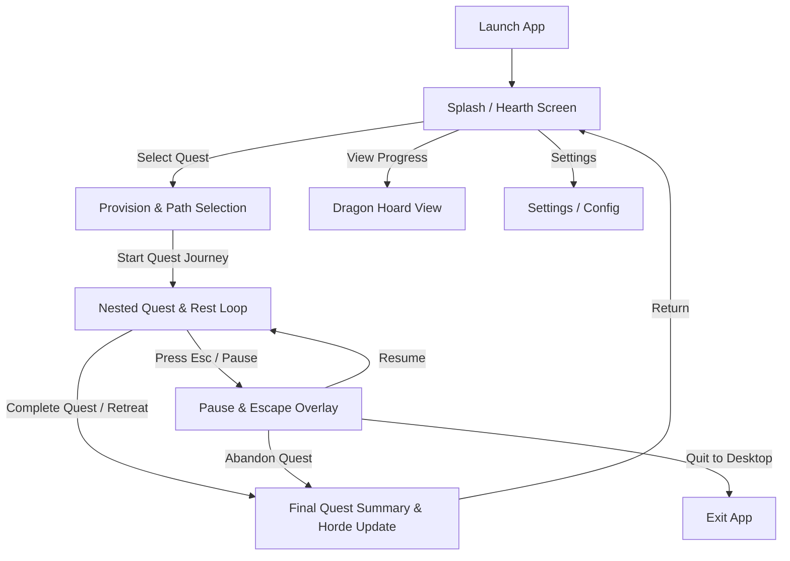
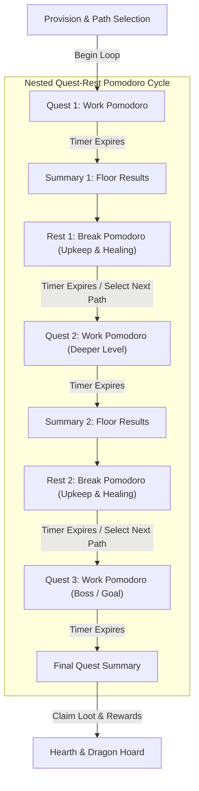

# UI Architecture & User Flow Discovery

## 1. Map of User Flows

Based on `plan/screens.md`, `plan/screens_simple.md`, `plan/mission.md`, and `plan/initial-path.md`, PomQuest follows a structured navigation and game loop:

### High-Level Navigation Flow



### Nested Quest & Rest Pomodoro Loop Flow



### Flow Descriptions

1. **Hearth Screen (Dashboard)**:
   - Display: Dragon / Dark Lord banner, cumulative statistics, current active run status.
   - User Actions: [1] Begin New Quest / Continue, [2] View Dragon Hoard, [3] Settings, [4] Quit.

2. **Provision & Path Selection (Pre-Quest)**:
   - Display: Location description, available biomes/paths, current party supplies (gold, food, spare parts, oxen, regents).
   - User Actions: Adjust diet/ration pace (`Sparse`, `Balanced`, `Generous`), select next destination/biome path, confirm work duration.

3. **Active Questing View (Working Pomodoro Cycle)**:
   - Display: Minimal interaction auto-crawler view during working focus time.
     - **Top**: Pomodoro Timer Bar (countdown, loop count, current focus phase).
     - **Middle-Left**: Event Log (encounter rolls, trap disarms, creature attacks with dice symbols `󰇍 󰇌`, damage notifications).
     - **Middle-Right / Grid**: Hero Cards (Hero stats, status badges, dynamic HP gauge).
     - **Bottom**: Party Supplies & Status Bar (Coin, food, oxen count, diet mode).
   - User Actions: Press `[P]` or `[Esc]` to pause/overlay menu; optional `[Space]` to jingle dice for next roll.

4. **Post-Quest Summary & Rest Phase (Break Pomodoro)**:
   - Display: Dungeon exploration summary (rooms cleared, enemies slain, XP & loot collected).
   - User Actions: Transition into Break Pomodoro; configure rest actions (foraging, wagon maintenance, healing) or return to Hearth.

5. **Pause & Global Exit Overlay**:
   - Display: Modal prompt over current screen when pressing `Esc`.
   - Options: Resume, Abandon Quest (roll escape chance with potential loot penalty), Exit Game.

---

## 2. UI Component Architecture Tree

To ensure consistency, shared theming, and modular Bubble Tea design, all UI elements are divided into **Generic Library UI Components** (`internal/ui/lib`) and **Domain-Specific Components** (`internal/ui/components`).

```
App Root Model (internal/ui/app.go)
│
├── Generic UI Library (internal/ui/lib/)
│   ├── Box (Bordered container with titles, padding, focus state)
│   ├── ProgressBar (Custom gauge for timers, HP bars, path distance)
│   ├── StatusBadge (Inline pill badges for ailments & statuses)
│   ├── Card (Compact framed card container)
│   ├── LogView (Auto-scrolling, category-filtered log message stream)
│   ├── Menu (Navigable key-bound option selector)
│   └── KeyValueGrid (Columnar key-value stat display layout)
│
└── Domain Components (internal/ui/components/)
    ├── HeaderView (Uses Box + KeyValueGrid)
    │   └── Displays Dark Lord title, location, and global state.
    ├── TimerBar (Uses ProgressBar + Box)
    │   └── Renders active Pomodoro timer, phase indicator, and loop counter.
    ├── HeroCard (Uses Card + ProgressBar + StatusBadge)
    │   └── Renders hero class icon, stats (Str/Dex/Con), HP gauge, and status pills.
    ├── HeroPartyGrid (Uses Box + array of HeroCard)
    │   └── Handles responsive 1x4, 2x2, or stacked horizontal layout for party cards.
    ├── PartySuppliesBar (Uses KeyValueGrid + Box)
    │   └── Displays coin breakdown (g/s/c), food lbs, oxen, spare parts, and diet strategy.
    ├── EventLogView (Uses LogView + Box)
    │   └── Streams formatted dungeon logs with Nerd Font dice icons (󰇊 󰇋 󰇌 󰇍 󰇎 󰇏).
    ├── QuestSummaryModal (Uses Box + KeyValueGrid + Menu)
    │   └── Formats post-quest loot, slain monsters, and room progress recap.
    ├── ProvisionMenu (Uses Menu + KeyValueGrid)
    │   └── Controls supply purchasing and ration allocation before quests.
    └── ExitOverlayModal (Uses Box + Menu)
        └── Renders full-screen modal for pausing, escaping, or exiting.
```

---

## 3. Shared Design System & Responsiveness

### Color Tokens & Styling (Lip Gloss)
- **Primary / Headings**: Violet / Cyan accents (`#875Af7`, `#00D7FF`).
- **Text & Highlight**: Soft white (`#E4E4E4`) and Gold (`#FFD700`) for coin/rewards.
- **Muted / Borders**: Slate gray (`#4A4A4A`, `#303030`).
- **Ailments / Statuses**:
  - `Fire / Sick`: Coral Red (`#FF5555`)
  - `Poison`: Emerald Green (`#50FA7B`)
  - `Dysentery / Cursed`: Purple (`#BD93F9`)
  - `Tired`: Muted Amber (`#F1FA8C`)

### Terminal Responsiveness Breakpoints
As outlined in `plan/screens_simple.md`:
- **xs (< 45 cols)**: Single-column stacked view (Timer -> Event Log -> Party status -> Stacked Hero cards).
- **sm (45 - 90 cols)**: 2-column layout (Left: Event log & supplies; Right: 2x2 Hero cards grid).
- **md/lg (> 90 cols)**: Full dashboard view (Top: Header & Timer; Center-Left: Log View; Center-Right: Horizontal 4-Hero cards row; Bottom: Party supplies bar).
